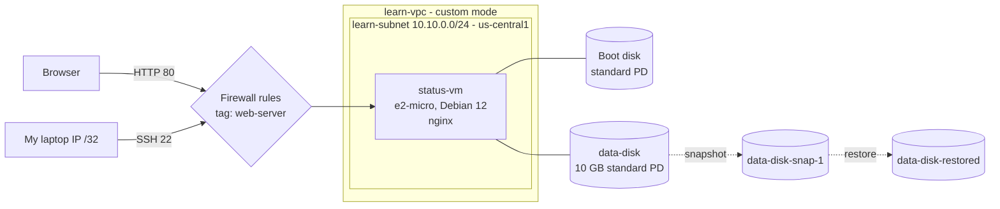

# GCP Project 1: Status Page on a Free e2-micro VM

A hands-on project to learn the core Google Cloud compute and networking building blocks by creating them manually in the Cloud Console: a custom VPC, firewall rules, a Compute Engine VM that serves a web page, and a persistent disk with snapshot-based backup and restore.

Everything stays within the GCP Always Free tier (1 e2-micro VM in a US free-tier region, standard persistent disk).

## What I built



## Concepts covered

| Concept | What I learned |
|---|---|
| VPC | A VPC is global; subnets are regional. A custom-mode VPC starts with no firewall rules, so all inbound traffic is blocked until I allow it. |
| Firewall rules | Rules attach to **network tags**, not to individual VMs. Any VM carrying the tag gets the rule. |
| Compute Engine | Machine types, zones, startup scripts, metadata server, browser SSH. |
| Persistent Disk | Block storage that exists separately from the VM; must be formatted and mounted before use. |
| Snapshots | Incremental backups of a disk, used to restore into a brand-new disk. |

## Steps

### 1. Custom VPC and subnet
- **VPC network → Create VPC network**
- Name `learn-vpc`, subnet mode **Custom**
- Subnet `learn-subnet`, region `us-central1`, range `10.10.0.0/24`

### 2. Firewall rules
Both rules: network `learn-vpc`, direction Ingress, action Allow, target tag `web-server`.

| Rule | Source ranges | Protocol/port |
|---|---|---|
| `allow-ssh-my-ip` | `<my-public-ip>/32` (plus `35.235.240.0/20` for the console SSH button) | TCP 22 |
| `allow-http` | `0.0.0.0/0` | TCP 80 |

### 3. Create the VM
- Name `status-vm`, region `us-central1`, machine type **e2-micro**
- Boot disk: Debian 12, **Standard persistent disk**, 30 GB or less
- Network: `learn-vpc` / `learn-subnet`, network tag `web-server`
- Startup script:

```bash
#!/bin/bash
apt-get update
apt-get install -y nginx
HOST=$(hostname)
ZONE=$(curl -s -H "Metadata-Flavor: Google" \
  http://metadata.google.internal/computeMetadata/v1/instance/zone | awk -F/ '{print $NF}')
cat > /var/www/html/index.html <<EOF
<h1>Status page</h1>
<p>Host: $HOST</p>
<p>Zone: $ZONE</p>
<p>Updated: $(date)</p>
EOF
systemctl enable --now nginx
```

Open `http://<external-ip>` to see the page.

### 4. Add and mount a second disk
1. **Compute Engine → Disks → Create disk**: `data-disk`, standard PD, 10 GB, same zone as the VM.
2. Edit the VM and attach `data-disk`.
3. In SSH:

```bash
lsblk                                  # confirm the device name (e.g. sdb)
sudo mkfs.ext4 -m 0 -F /dev/sdb        # format once only
sudo mkdir -p /mnt/data
sudo mount /dev/sdb /mnt/data
sudo chmod a+w /mnt/data
echo "hello from persistent disk" > /mnt/data/test.txt
```

### 5. Snapshot and restore
1. **Compute Engine → Snapshots → Create snapshot** from `data-disk` (`data-disk-snap-1`).
2. Delete the test file, unmount, detach `data-disk`.
3. Create a new disk `data-disk-restored` from the snapshot, attach it, then mount it **without** running `mkfs`:

```bash
sudo mount /dev/sdb /mnt/data
cat /mnt/data/test.txt     # file is back
```

## Troubleshooting log

**Problem:** `ERR_CONNECTION_TIMED_OUT` when opening the VM's external IP.

**Cause:** The VM's network tag was `webserver`, but the firewall rules targeted `web-server`. Tags must match exactly, so neither rule applied to the VM and the traffic was silently dropped.

**Fix:** Edited the VM's network tag to `web-server`. The page loaded about 30 seconds later.

**Takeaways**
- A timeout usually means a firewall is dropping traffic; "connection refused" means something reached the VM but nothing was listening.
- Debug in order: URL scheme (`http://`), tag on the VM, rule fields, then `curl localhost` on the VM itself.
- Be consistent with tag naming, since a one-character difference breaks the rule.

## Free-tier notes
- Use a free-tier region (`us-central1`, `us-east1` or `us-west1`) for the e2-micro.
- Use **standard** persistent disk, not balanced.
- Snapshots are billed beyond a small free amount, so delete them when finished.
- Set a billing budget alert before creating anything.

## Cleanup
1. Delete `data-disk`, `data-disk-restored` and the snapshot.
2. Stop or delete `status-vm`.
3. Delete `learn-vpc` last (it cannot be removed while resources still use it).

## Next
Project 2: auto-thumbnail drop box with Cloud Storage and Cloud Run functions.
